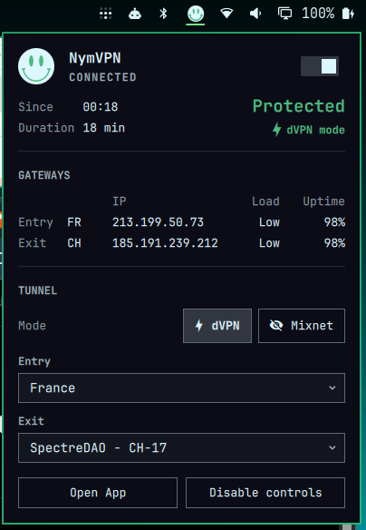

# NymVPN for Omarchy

*Created: October 14, 2026 -- Updated: October 16, 2026*

Unofficial [NymVPN](https://nym.com) status for the [Omarchy](https://omarchy.org) bar: no password prompts, no changes to your system or daemon settings, and an alert when the tunnel drops.



> [!note]
> This is a community plugin. It is not affiliated with, endorsed by, or supported by Nym Technologies SA. NymVPN, the Nym name, logo and smiley are trademarks of Nym Technologies SA. For NymVPN itself, use the [NymVPN docs](https://nym.com/docs), [Nym support](https://support.nym.com) and [nymtech/nym-vpn-client](https://github.com/nymtech/nym-vpn-client).

## What the NymVPN plugin does

- **Bar smiley** — Nym's smiley, with green eyes and smile while the tunnel is up and cut out in the bar color otherwise. Hover for the state and route; left click opens the status card; right click opens the NymVPN app.
- **Status card** — state, connected since, duration, Protected / Unprotected / No network, dVPN or Mixnet mode, and the entry and exit gateways (country, IP, load, uptime; hover for IPv6 and node name).
- **Toasts** — "NymVPN connected" when the tunnel comes up, and a critical "NymVPN disconnected" toast when it drops. The critical toast shows through Do Not Disturb and stays until dismissed. Suspend and Wi-Fi loss, where NymVPN reconnects by itself, do not toast. When the tunnel state cannot be read (log unreadable, or a state the plugin does not know), the widget shows "Unknown", never "Protected", and sends one normal "NymVPN status unknown" toast.
- **Optional controls** — once enabled, the card can connect and disconnect, switch between dVPN and Mixnet, and pick the entry and exit gateway (Auto, Random, or a country).

The plugin reads the tunnel state from the NymVPN daemon log, `/var/log/nym-vpnd/nym-vpnd.log`. It works whether the NymVPN app is open or closed, and never calls the polkit-protected `nym-vpnc` just to show the state, so it never triggers a password prompt.

## Requirements and installation

Tested on Omarchy 4.0.4 with NymVPN 2026.13.0 (October 2026).

- **Required** — the NymVPN daemon, running: `omarchy pkg aur add nym-vpnd-bin`, then `sudo systemctl enable --now nym-vpnd`.
- **For "Open App"** — the NymVPN app: `omarchy pkg aur add nym-vpn-app-bin`.
- **For the controls** — the NymVPN CLI: `omarchy pkg aur add nym-vpnc-bin`.
- **Already on Omarchy** — `jq`, `gum`, `polkit`, `iso-codes`, `notify-send`.

Install and enable:

```bash
omarchy plugin add https://github.com/phil71x/omarchy-nymvpn.git --enable
```

The smiley lands in the right section of the bar. To place it elsewhere, for example before the network icon: `omarchy plugin enable io.github.phil71x.nymvpn --section right --before omarchy.network`.

Update with `omarchy plugin update io.github.phil71x.nymvpn`.

To remove the plugin, first click **Disable controls** in the card if you enabled them, so the polkit rule and the group membership go away. Then run:

```bash
omarchy plugin remove io.github.phil71x.nymvpn
rm -rf ~/.cache/io.github.phil71x.nymvpn
```

## Enabling the NymVPN controls

Without setup, the card is read-only: NymVPN's polkit policy asks for your password on every `nym-vpnc` call, and a bar widget must never cause password prompts. The card then shows **Enable controls**.

**Enable controls** opens Omarchy's floating terminal, explains each change and asks for confirmation before running `sudo`:

1. Adds you to the group `nym-vpn`, created by the `nym-vpnd-bin` package.
2. Installs [`polkit/50-io.github.phil71x.nymvpn.rules`](polkit/50-io.github.phil71x.nymvpn.rules) to `/etc/polkit-1/rules.d/`. The rule lets members of `nym-vpn`, in a local and active session, use the NymVPN daemon (`com.nymvpn.vpnd.unix-access`) without a password.

Any program running as you can then control NymVPN without a password. **Disable controls** in the card undoes both changes the same way.

Each control action takes a few seconds, the time `nym-vpnc` takes to answer. A change of mode or gateway while connected reconnects the tunnel.

## Settings and IPC

Settings are fields on the widget's entry in `~/.config/omarchy/shell.json`:

- **Connected color** (`connectedColor`, default `#4CBB7F`, a softened Nym green) — smiley color while the tunnel is up.
- **Notifications** (`notifications`, default on) — connect, disconnect and status unknown toasts.
- **Fallback check** (`refreshIntervalSec`, default 5, 2 to 60) — the status follows the daemon log as soon as it changes; this periodic check also catches a stopped or crashed daemon, which writes nothing.

Open and close the card from a keybinding or a script:

```bash
omarchy-shell shell summon io.github.phil71x.nymvpn '{}'
omarchy-shell shell hide io.github.phil71x.nymvpn
```

## Privacy and security

- **Read only by default** — the plugin reads the daemon log and, with controls enabled, calls `nym-vpnc`. It makes no network requests of its own and sends no telemetry.
- **No password prompts** — before any `nym-vpnc` call, `pkcheck` checks that polkit allows it without a password; otherwise the call is not made.
- **No hidden system changes** — the only system changes are the two made by **Enable controls**, in a visible terminal, after confirmation, and reverted by **Disable controls**. The plugin never changes NymVPN settings, never adds VPN bypasses, and never runs `sudo` from the bar.
- **Files written** — the last state in `$XDG_RUNTIME_DIR/io.github.phil71x.nymvpn/` (cleared at reboot) and gateway lists in `~/.cache/io.github.phil71x.nymvpn/`.

To report a vulnerability, see [SECURITY.md](SECURITY.md).

## Troubleshooting

- **The smiley never turns green** — check what the widget reads: `bash ~/.config/omarchy/plugins/io.github.phil71x.nymvpn/scripts/nym-status | jq .`. An empty `state` means the daemon log is missing or unreadable at `/var/log/nym-vpnd/nym-vpnd.log`. A NymVPN update that rewords its log lines can also break the plugin: please open an issue.
- **Load column empty** — loads come from the gateway lists, fetched only while controls are enabled, and are hidden once over an hour old.
- **"Enable controls" stops at the confirmation** — `gum confirm` takes the keyboard (arrows and Enter); a mouse click cancels it.
- **"Group nym-vpn not found"** — install `nym-vpnd-bin`, which creates the group.
- **"Process crashed: WebKitWebProcess" when quitting the NymVPN app** — a crash of the NymVPN app's web view at exit, not of this plugin.

## License

[MIT](LICENSE). NymVPN and the Nym marks belong to Nym Technologies SA; see the note at the top of this README.
